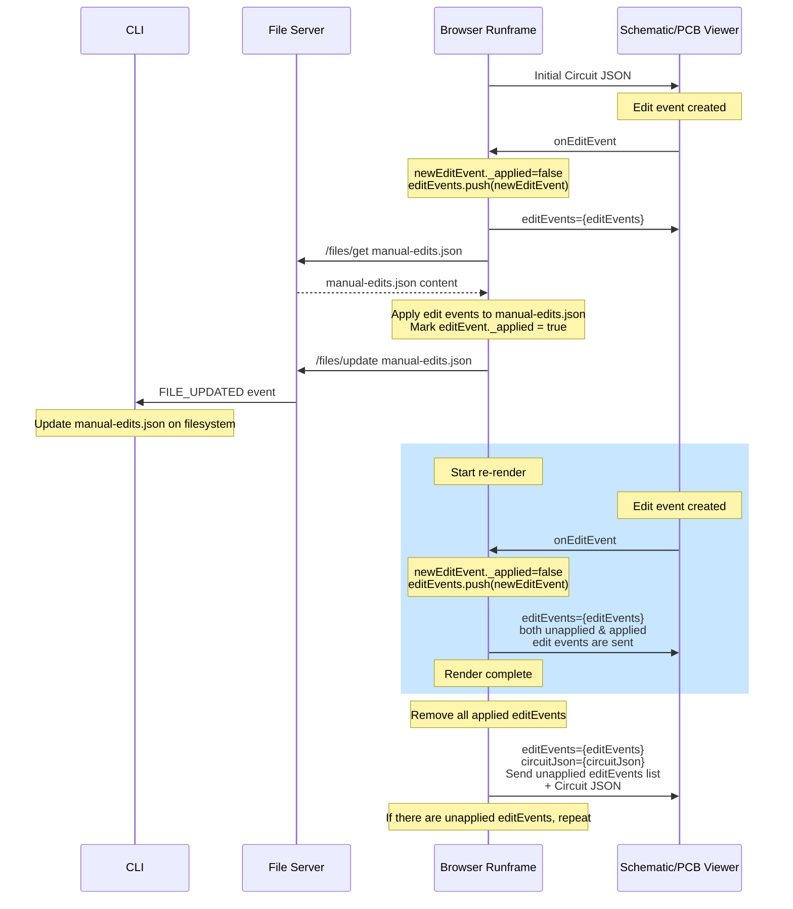

# @tscircuit/runframe

[tscircuit](https://github.com/tscircuit/tscircuit) ⋅ [View Examples](https://runframe.vercel.app)

A React component that runs tscircuit inside a webworker and shows you the PCB,
Schematic, 3D and other previews.

- Automatically imports other snippets and libraries if imported
- Runs inside webworker (doesn't block the main thread)
- Converts typescript to javascript using babel

## Usage

```tsx
import { RunFrame } from "@tscircuit/runframe/runner"

const App = () => (
  <RunFrame
    fsMap={{
      "main.tsx": `
circuit.add(
  <resistor resistance="1k" />
)
`,
    }}
    entrypoint="main.tsx"

    // Listen to events
    onCircuitJsonChange={(circuitJson) => void}
    onRenderingFinished={({ circuitJson }) => void}
    onRenderEvent={(event) => void}
    onError={(error) => void}
    availableTabs={["pcb", "schematic", "cad"]}
    defaultTab="pcb"
  />
)
```

### Configuring AI

Runframe accepts an [AI SDK](https://ai-sdk.dev/) `LanguageModel` through the
optional `ai` prop on `RunFrame`, `RunFrameWithApi`, and `RunFrameForCli`:

```tsx
import type { LanguageModel } from "ai"
import { RunFrame } from "@tscircuit/runframe/runner"

function Preview({ model }: { model: LanguageModel }) {
  return <RunFrame fsMap={files} ai={{ model }} />
}
```

The host app passes the model chosen by its user and configures its transport to
an authenticated backend proxy. Keep provider API keys on that backend. Runframe
does not read environment variables, choose a default provider, or store keys.
The model must implement an AI SDK v2, v3, or v4 language model interface.

Supplying `ai` only makes the configuration available; it does not invoke the
model. Descendants can access it with `useRunFrameAi()`. Standalone dialogs can
share a configuration through the exported `RunFrameAiProvider`. Each frame
has its own provider, and omitting `ai` disables AI for that frame.

Model objects contain functions and cannot cross the `RunFrameWithIframe`
`postMessage` boundary. Configure the model inside the iframe instead.

### Creating components from a datasheet

With `ai` configured, choose **Create from datasheet** in the preview toolbar. The
button remains visible when `showFileMenu={false}`, as used by the tscircuit.com
editor's `SuspenseRunFrame` wrapper. Drop one PDF (up to 20 MB) and click
**Generate assets**. The AI automatically chooses a documented part and package,
including for family datasheets, and explains its choice in the result. There is
no part/package entry or clarification step. The model must support PDF input
and structured JSON output; Runframe sends the PDF bytes directly, including
package drawings. Opening the dialog, choosing a file or changing a toggle does
not send a request.

Two optional toggles, both off by default, add reusable circuit modules:

- **Generate simulation circuit** creates a connected tscircuit group with the
  chip's behavioral model, supplies, stimulus, loads, probes and ngspice transient
  analysis. The standalone chip and SPICE model are still available.
- **Generate reference circuit** creates a reference application group with the
  chip and supporting wiring/components, without simulation analysis, probes,
  artificial test sources or an attached SPICE model.

After review, choose **Use chip alone**, **Use simulation circuit** or
**Use reference circuit** when that output is available. Download ZIP includes
all generated files. Acceptance supplies the chosen module to the host through
an optional second callback argument, `{ kind, entrypoint }`.

Results contain tscircuit TSX files for a footprint, schematic symbol and combined
component, plus an AI-generated behavioral SPICE macro-model synthesized from
the documented electrical characteristics. An existing SPICE netlist in the PDF
is not required. The model describes its assumptions and omitted effects; a dual
op amp's macro-model includes both channels and the documented physical pin map.
Insufficient information produces unavailable assets and warnings. Generated files
are drafts: review their pin mapping, dimensions, cited PDF pages and assumptions.
Runframe validates the response structure and filenames; it does not certify the
generated circuit geometry, TSX behavior, or electrical accuracy.

Inspect the source in the dialog, download a ZIP (including generation notes), or
pass a callback to receive files and the chosen chip/circuit entrypoint:

```tsx
import { getDatasheetAssetFiles, RunFrame } from "@tscircuit/runframe/runner"

<RunFrame
  fsMap={files}
  ai={{ model }}
  onDatasheetAssetsGenerated={async (assets, selection) => {
    const generatedFiles = getDatasheetAssetFiles(assets, selection?.kind)
    await saveNewFiles(generatedFiles) // Your host's file creation flow
    if (selection) {
      await useGeneratedModule(selection.entrypoint) // Place it in your board
    }
  }}
/>
```

The callback is also supported by `RunFrameWithApi` and `RunFrameForCli`. The host
owns persistence and conflict handling. Generation never executes the resulting
TSX or overwrites project files. A failed save leaves the reviewed result available
for retry or download. Canceling, closing, or replacing the file invalidates a
pending generation.

For a custom launcher, render the exported `DatasheetImportDialog` inside a
`RunFrameAiProvider`. Its props are `isOpen`, `onClose`, and optional
`onAssetsGenerated`. `generateDatasheetAssets({ ai, file,
generateSimulationCircuit, generateReferenceCircuit, abortSignal })` is also
exported for custom hosts; both generation flags default to false. The returned
`simulationCircuit` and `referenceCircuit` are nullable TSX assets. Use
`getDatasheetAssetFiles(assets, selection?.kind)` to include the selected circuit
and shared chip dependencies; omit the selection to collect every generated file.
The `entrypoint` is a reusable module for placement inside the host's board.
One-argument callbacks remain supported.

The Cosmos `example66-datasheet-import` fixture uses the website's `RunFrame`
component with source files, a Run button, and a hidden File menu. It opens on a
populated 3D view, with PCB and schematic tabs and the datasheet toolbar action.
Accepted files appear in the editor; Run updates the board with the generated
component. This fixture contains no mock AI model or canned component results.
Choose **Configure AI**. OpenAI is selected by default and uses the hardcoded
`gpt-6-astra` model, with no model ID input. Anthropic, Google Gemini and
OpenAI-compatible services remain available with an explicit model ID. The
standard providers have **Sign in** links to their
official account consoles. These open a new tab; they do not perform OAuth or
automatically grant Runframe model access. For this personal preview, return with
a provider API key. Standard provider addresses are automatic. No connection is
active until the user configures it. Keys stay in tab memory, go only to that
provider, and clear on reload or disconnect.

Production websites should manage authentication and provider keys on their
backend and supply the resulting `ai={{ model }}`. The preview also supports
**Use my own server** with an optional website session token. The server supplies
its own provider key, permits the preview origin, and accepts the PDF payload.
Use a Responses API base URL for OpenAI, Messages for Anthropic, Gemini for
Google, or Chat Completions for an OpenAI-compatible service. Configuration stays
in memory. Without a connection the preview reports that AI is not configured
and cannot generate files; provider errors are surfaced without substituting sample assets.

The preview uses the official provider adapters. A host using any other AI SDK
provider can supply its user's configured `ai={{ model }}` directly to `RunFrame`;
the library is provider-neutral.

### System block diagrams

Choose **System** from the **More views** dropdown to display system block
pages from Circuit JSON. The viewer uses the resolved block sizes, positions,
and routes, with a page selector for multiple diagrams. The standalone
`@tscircuit/system-block-viewer` package provides the same drag, scroll, and
touch gestures as schematic-viewer, without zoom buttons.

Use `defaultActiveTab="system"` to open it initially, or
`availableTabs={["system"]}` for a System-only preview. Circuits without
`system_block_page` records show an empty state.

### Using CircuitJsonPreview Directly

If you already have circuit JSON and just want to display it:

```tsx
import { CircuitJsonPreview } from "@tscircuit/runframe/preview"

const App = () => (
  <CircuitJsonPreview
    circuitJson={myCircuitJson}
    // Optional props
    showCodeTab={false}      // Show/hide the code editor tab
    showJsonTab={true}       // Show/hide the raw JSON viewer tab
    className="h-screen"     // Container className
    headerClassName="px-4"   // Header className
    isFullScreen={false}     // Toggle fullscreen mode
    onToggleFullScreen={() => void}  // Fullscreen toggle callback
  />
)
```

### Using RunFrameStaticBuildViewer for Lazy-Loaded Circuit JSON

For displaying circuit JSON files that are fetched on-demand without code execution:

```tsx
import { RunFrameStaticBuildViewer } from "@tscircuit/runframe"

const App = () => (
  <RunFrameStaticBuildViewer
    files={[
      {
        filePath: "main.circuit.json",
        fileStaticAssetUrl: "https://api.example.com/circuits/main.json"
      },
      {
        filePath: "components/sensor.circuit.json", 
        fileStaticAssetUrl: "https://api.example.com/circuits/sensor.json"
      }
    ]}
    // Optional: Custom fetch function for authentication, caching, etc.
    onFetchFile={async (fileRef) => {
      const response = await fetch(fileRef.fileStaticAssetUrl, {
        headers: { Authorization: 'Bearer token' }
      })
      return response.json()
    }}
    projectName="My Project"
    defaultToFullScreen={false}
    showToggleFullScreen={true}
  />
)
```

When multiple files are provided, the viewer includes a circuit gallery. Gallery
cards look for preview assets next to each `circuit.json`, preferring `3d.png`
and falling back to PCB or schematic PNG/SVG assets. Add `gallery` to either the
query string or hash (for example, `?gallery` or `#gallery=true`) to open the
gallery directly.

### Providing the Blob URL (to avoid loading webworker from CDN)

```tsx
import evalWebWorkerBlobUrl from "@tscircuit/eval/blob-url"
```

### Standalone Iframe

RunFrame can be embedded in an iframe, allowing you to evaluate tscircuit code from a parent application. There are two main ways to integrate RunFrame: using the React component or creating a standalone iframe implementation.

```html
<!DOCTYPE html>
<html>
  <head>
    <title>RunFrame Host</title>
  </head>
  <body>
    <iframe
      id="runframe"
      src="https://runframe.tscircuit.com/iframe.html"
      style="width: 100%; height: 600px; border: none;"
    ></iframe>

    <script>
      const iframe = document.getElementById("runframe")

      // Listen for ready message from iframe
      window.addEventListener("message", (event) => {
        if (event.data?.runframe_type === "runframe_ready_to_receive") {
          // Send circuit configuration
          iframe.contentWindow.postMessage(
            {
              runframe_type: "runframe_props_changed",
              runframe_props: {
                fsMap: {
                  "main.tsx": `circuit.add(<resistor resistance="1k" />)`,
                },
                entrypoint: "main.tsx",
              },
            },
            "*"
          )
        }
      })
    </script>
  </body>
</html>
```

#### Listening for events from the iframe

```tsx
window.addEventListener("message", (event) => {
  if (event.data?.runframe_type === "runframe_event") {
    const { type } = event.data.runframe_event
    if (type === "error") {
      console.error(event.data.runframe_event.error_message)
    }
  }
})
```

## Development

### File-Server Interaction with Edit Events

Edit events can be a complex to understand, because it can take some
time for rendering to complete, edit events are applied for an
approximate render before the circuit is fully rendered. The sequence
diagram below can be used as a reference to understand how the edit events
are applied and queued for rendering.



### `<RunFrameWithApi />` and `<RunFrameForCli />` Event Bus

The event bus for the RunFrame is accessible from the `@tscircuit/file-server`
`/events/list` endpoint. RunFrame creates the following events:

| Event Name              | Description                                             |
| ----------------------- | ------------------------------------------------------- |
| FILE_UPDATED            | A file was updated                                      |
| REQUEST_TO_SAVE_SNIPPET | Browser request to save the current circuit to snippets |
| FAILED_TO_SAVE_SNIPPET  | Failed to save the current snippet to Registry          |
| SNIPPET_SAVED           | Snippet was saved to Registry                           |


### Extra iframe tabs

RunFrame, CircuitJsonPreview, RunFrameWithApi, RunFrameForCli, and
RunFrameStaticBuildViewer accept `extraTabs`. Import `ExtraRunFrameTab` from
`@tscircuit/runframe` or `@tscircuit/runframe/runner`:

```tsx
<RunFrame
  fsMap={files}
  mainComponentPath="boards/controller.tsx"
  extraTabs={[
    {
      tabName: "Sysconfig",
      iframeUrl: "https://sysconfig-viewer.tscircuit.com/#encodedcontent",
      mainComponentPath: "boards/controller.tsx",
    },
  ]}
/>
```

Omit `mainComponentPath` for a project-wide tab. The RunFrame, API/CLI, and
static-build wrappers filter scoped tabs against the selected circuit path.
CircuitJsonPreview accepts the already-selected views. Static-build paths must
match `files[].filePath`. Different circuits may each define a tab named
`Sysconfig`; duplicate names within the selected circuit are ignored after the
first valid descriptor. Blank names, malformed URLs, credential-bearing URLs,
and protocols other than HTTP(S) are ignored.

Extra views appear in **More views**, with the selected view also shown in the
header. They are additional to `availableTabs`, which filters built-in views.
Use `defaultActiveTab="extra:Sysconfig"` to select this example initially; the
suffix is the URL-encoded tab name. Iframes load when first selected and remain
mounted between view changes. Removing the selected view falls back to an
available tab. Changing its URL navigates the existing iframe to the new page.

For the standalone CLI bundle, inject the global before loading the bundle:

```html
<script>
  window.TSCIRCUIT_EXTRA_RUNFRAME_TABS = [
    { tabName: "Sysconfig", iframeUrl: "https://sysconfig-viewer.tscircuit.com/#encodedcontent" }
  ];
</script>
```

For live updates, replace that array and dispatch
`window.dispatchEvent(new Event("tscircuit:extra-runframe-tabs-change"))`.
React consumers update the `extraTabs` prop instead.

Pages must be trusted by the embedding application. Frames use
`sandbox="allow-scripts allow-same-origin"` so application assets and SDK data
can load, without granting popup, form, or top-level navigation capabilities.
An iframe served from the parent's own origin shares that origin's trust;
use a separate origin for external viewers. The framed page controls read-only
behavior and must allow framing through its response headers.

`example62-extra-iframe-tabs` demonstrates transport, retained navigation, and
circuit scoping using a local read-only sample. It is not a TI SysConfig parity
demo and does not implement SysConfig parsing or URL encoding.
