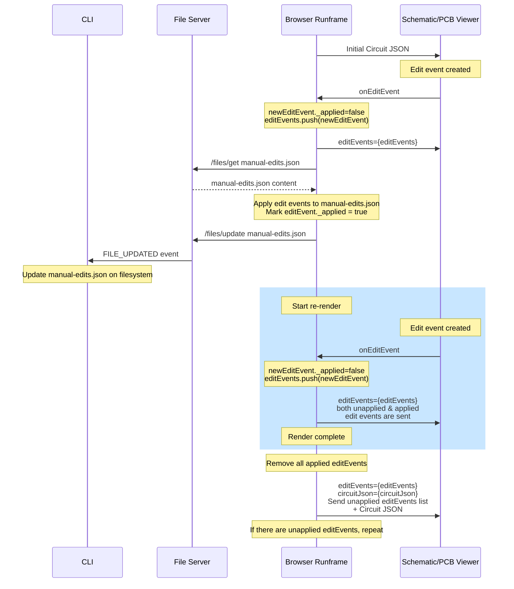

# @tscircuit/runframe

[tscircuit](https://github.com/tscircuit/tscircuit) ⋅ [View Examples](https://runframe.vercel.app)

A React component that runs tscircuit inside a webworker and shows you the PCB,
Schematic, 3D and other previews.

- Automatically imports other snippets and libraries if imported
- Runs inside webworker (doesn't block the main thread)
- Converts typescript to javascript using babel

## Usage

```tsx
import { RunFrame } from "@tscircuit/runframe/runner"

const App = () => (
  <RunFrame
    fsMap={{
      "main.tsx": `
circuit.add(
  <resistor resistance="1k" />
)
`,
    }}
    entrypoint="main.tsx"

    // Listen to events
    onCircuitJsonChange={(circuitJson) => void}
    onRenderingFinished={({ circuitJson }) => void}
    onRenderEvent={(event) => void}
    onError={(error) => void}
    availableTabs={["pcb", "schematic", "cad"]}
    defaultTab="pcb"
  />
)
```

### Using CircuitJsonPreview Directly

If you already have circuit JSON and just want to display it:

```tsx
import { CircuitJsonPreview } from "@tscircuit/runframe/preview"

const App = () => (
  <CircuitJsonPreview
    circuitJson={myCircuitJson}
    // Optional props
    showCodeTab={false}      // Show/hide the code editor tab
    showJsonTab={true}       // Show/hide the raw JSON viewer tab
    className="h-screen"     // Container className
    headerClassName="px-4"   // Header className
    isFullScreen={false}     // Toggle fullscreen mode
    onToggleFullScreen={() => void}  // Fullscreen toggle callback
  />
)
```

### Using RunFrameStaticBuildViewer for Lazy-Loaded Circuit JSON

For displaying circuit JSON files that are fetched on-demand without code execution:

```tsx
import { RunFrameStaticBuildViewer } from "@tscircuit/runframe"

const App = () => (
  <RunFrameStaticBuildViewer
    files={[
      {
        filePath: "main.circuit.json",
        fileStaticAssetUrl: "https://api.example.com/circuits/main.json"
      },
      {
        filePath: "components/sensor.circuit.json", 
        fileStaticAssetUrl: "https://api.example.com/circuits/sensor.json"
      }
    ]}
    // Optional: Custom fetch function for authentication, caching, etc.
    onFetchFile={async (fileRef) => {
      const response = await fetch(fileRef.fileStaticAssetUrl, {
        headers: { Authorization: 'Bearer token' }
      })
      return response.json()
    }}
    projectName="My Project"
    defaultToFullScreen={false}
    showToggleFullScreen={true}
  />
)
```

When multiple files are provided, the viewer includes a circuit gallery. Gallery
cards look for preview assets next to each `circuit.json`, preferring `3d.png`
and falling back to PCB or schematic PNG/SVG assets. Add `gallery` to either the
query string or hash (for example, `?gallery` or `#gallery=true`) to open the
gallery directly.

### Providing the Blob URL (to avoid loading webworker from CDN)

```tsx
import evalWebWorkerBlobUrl from "@tscircuit/eval/blob-url"
```

### Serving dynamic dependencies locally

Pass `platformConfig.jscdnBaseUrl` to `RunFrame`, `CircuitJsonPreview`, or
`RunFrameStaticBuildViewer` to load export converters and BOM dependencies from
an enterprise endpoint instead of the public CDN. This shared property is
introduced in [tscircuit/props#933](https://github.com/tscircuit/props/pull/933).
This property is available in `@tscircuit/props` version `0.0.702` and later.

```tsx
const platformConfig = {
  jscdnBaseUrl: "/jscdn",
  platformFetch: (input, init) => fetch(input, init),
}

<CircuitJsonPreview circuitJson={myCircuitJson} platformConfig={platformConfig} />
```

The endpoint must serve a self-contained browser ESM bundle at
`<jscdnBaseUrl>/<package>/<version>/+esm`; unversioned imports use `latest`.
Bundles must include their transitive JavaScript dependencies. Runframe fetches
bundle source through `platformFetch` (or `fetch` when the hook is omitted), then
imports a temporary blob URL. CSP policies must allow `blob:` module scripts.
A configured endpoint never falls back to a public CDN, and imported modules
are cached per platform configuration.

For either standalone entrypoint, set `window.TSCIRCUIT_PLATFORM_CONFIG` before
loading `standalone.min.js` or `standalone-preview.min.js`. This is a runtime
object, so it can contain callable hooks such as `platformFetch` without JSON
serialization. Static builds also pass the configuration to file loading,
previews, and the export menu.

This controls runframe's dynamic converter transport. Offline deployments must
also provide an evaluator worker, circuit resources, and platform services used
by their enabled viewers and features. Providing `evalWebWorkerBlobUrl` skips
public evaluator version metadata requests because the bundle already selects
the evaluator. Without an explicit or cached version, its diagnostic version
label is `bundled`.

### Standalone Iframe

RunFrame can be embedded in an iframe, allowing you to evaluate tscircuit code from a parent application. There are two main ways to integrate RunFrame: using the React component or creating a standalone iframe implementation.

```html
<!DOCTYPE html>
<html>
  <head>
    <title>RunFrame Host</title>
  </head>
  <body>
    <iframe
      id="runframe"
      src="https://runframe.tscircuit.com/iframe.html"
      style="width: 100%; height: 600px; border: none;"
    ></iframe>

    <script>
      const iframe = document.getElementById("runframe")

      // Listen for ready message from iframe
      window.addEventListener("message", (event) => {
        if (event.data?.runframe_type === "runframe_ready_to_receive") {
          // Send circuit configuration
          iframe.contentWindow.postMessage(
            {
              runframe_type: "runframe_props_changed",
              runframe_props: {
                fsMap: {
                  "main.tsx": `circuit.add(<resistor resistance="1k" />)`,
                },
                entrypoint: "main.tsx",
              },
            },
            "*"
          )
        }
      })
    </script>
  </body>
</html>
```

#### Listening for events from the iframe

```tsx
window.addEventListener("message", (event) => {
  if (event.data?.runframe_type === "runframe_event") {
    const { type } = event.data.runframe_event
    if (type === "error") {
      console.error(event.data.runframe_event.error_message)
    }
  }
})
```

## Development

### File-Server Interaction with Edit Events

Edit events can be a complex to understand, because it can take some
time for rendering to complete, edit events are applied for an
approximate render before the circuit is fully rendered. The sequence
diagram below can be used as a reference to understand how the edit events
are applied and queued for rendering.



### `<RunFrameWithApi />` and `<RunFrameForCli />` Event Bus

The event bus for the RunFrame is accessible from the `@tscircuit/file-server`
`/events/list` endpoint. RunFrame creates the following events:

| Event Name              | Description                                             |
| ----------------------- | ------------------------------------------------------- |
| FILE_UPDATED            | A file was updated                                      |
| REQUEST_TO_SAVE_SNIPPET | Browser request to save the current circuit to snippets |
| FAILED_TO_SAVE_SNIPPET  | Failed to save the current snippet to Registry          |
| SNIPPET_SAVED           | Snippet was saved to Registry                           |
