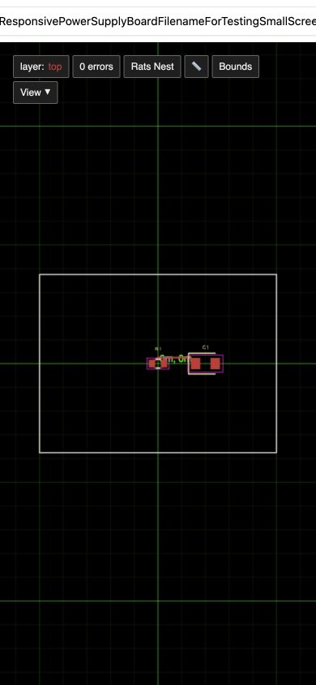
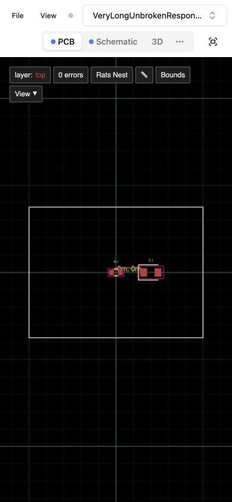
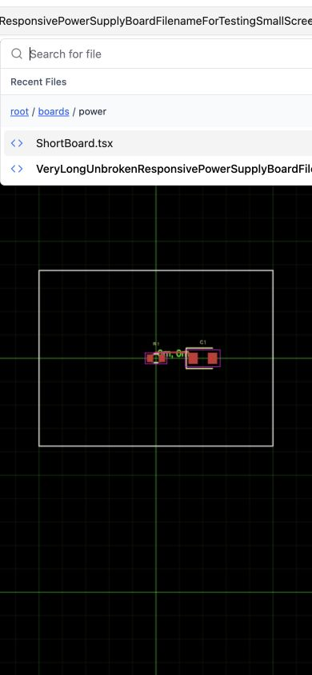
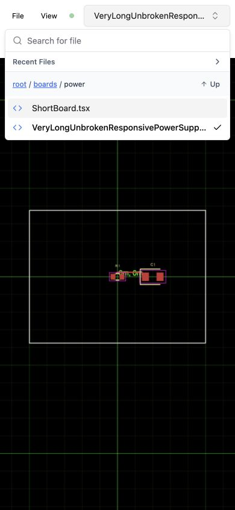

# Responsive preview rendered snapshots

These are genuine browser screenshot captures of the rendered Cosmos fixture,
not HTML/DOM serialization or generated mockups. They document the reproduction and fix;
they are not automated pixel-diff assertions.

## Capture conditions

- Fixture: `examples/example63-responsive-file-selector.fixture.tsx`.
- Broken runtime revision: `57332cbf1658eadac923d9e91a693eb02cfc27f0`.
- Fixed capture revision: `3b8587994e02ee2f723382bcf6db797ac1150049` (runtime code identical to `4081d1d6df558321a8839a713e4c8ca587ccda10`; the additional commit merges only the broken-state images and documentation).
- Browser: Codex in-app browser on macOS, 390 × 844 CSS pixels, device pixel ratio 1.
- Image format: JPEG, 390 × 844 pixels, full viewport, no cropping or image edits.
- Active view: PCB, render completed, initial fit, no pan/zoom, page scroll (0, 0).
- Selected file: `boards/power/VeryLongUnbrokenResponsivePowerSupplyBoardFilenameForTestingSmallScreenNavigation.tsx`.
- `before-closed.jpg`: selector closed, initial state.
- `before-open.jpg`: same state after opening the selector; empty search, recent files collapsed, `boards/power` folder.
- `after-closed.jpg` and `after-open.jpg`: matching states on the fixed revision, captured using a separate fresh origin with the same dependencies and browser.

The broken selector spans x = -142.53 to 532.53, covering the toolbar. The open
menu spans x = 0 to 715.03, exceeding the 390px viewport. With the fix, the selector
stays at x = 138.93 to 382 in the first row, tabs occupy y = 52 to 88 in the second
row, and the open menu stays at x = 8 to 382.

## Matched images

| State | Broken | Fixed |
| --- | --- | --- |
| Closed selector |  |  |
| Open selector |  |  |

## Repeat the capture

1. Check out the desired runtime revision above and install its dependencies.
2. Run `bun start` on an isolated preview server. The fixture seeds three synthetic
   TSX board files into that server, so do not reuse another project's server.
3. Open fixture 63 in the Codex in-app browser with a fresh origin/profile state.
   Use its standalone Cosmos renderer to omit the fixture navigation sidebar.
4. Set the viewport to 390 × 844 before loading the fixture (reload after changing
   the viewport). Wait until the PCB is rendered and the progress indicator disappears.
5. Capture the closed selector, then open it and capture again without typing,
   selecting another file, expanding recent files, scrolling, or changing zoom.

Use the same conditions for the fix comparison. The paired PR descriptions link
to immutable committed image revisions so they keep showing the captured state.
